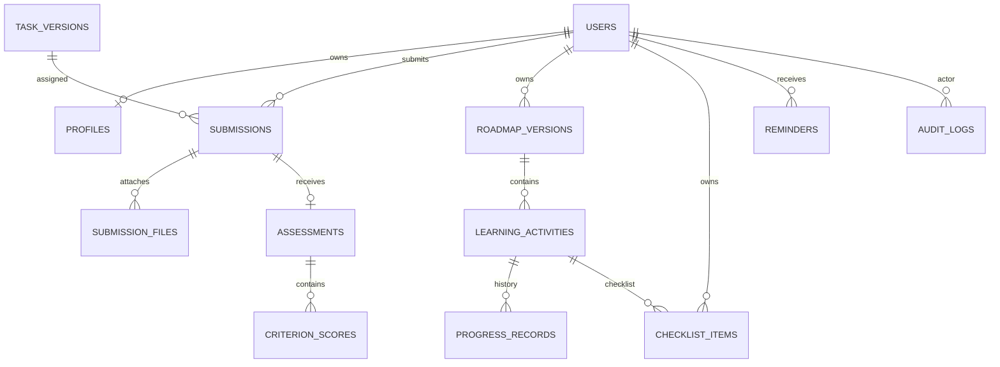

# CareerAdapt ERD (core data and ownership paths)

Use `db/migrations/001_users_profiles.sql` through `007_retention.sql` as the source of truth for column types, constraints and triggers. This diagram highlights personal-data ownership paths; it is not a complete depiction of all content/catalog tables.
