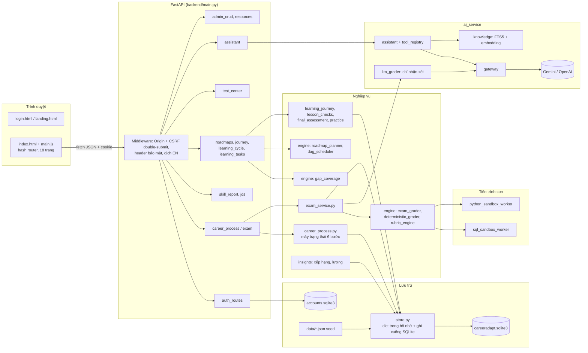

# Phần A. Khảo sát dự án và kiến trúc

Thuộc bộ báo cáo kiểm định ngày 12/11/2026. Tài liệu chính: [AUDIT_REPORT.md](../../AUDIT_REPORT.md).

## A1. Phạm vi đã đọc

| Khu vực | Số tệp | Số dòng (tự viết) | Ghi chú |
|---|---|---|---|
| `backend/` (Python) | 65 | 14.235 | Toàn bộ tệp đã được liệt kê; tệp lõi đọc toàn văn (xem A5) |
| `frontend/js/` (không tính `vendor/`) | 30, trong đó 18 trang | 4.797 | Router, trang, biểu đồ, i18n |
| `frontend/css/` | 5 | ~1.830 | `app.css` 1.394 dòng |
| `tests/` | 33 tệp test + 5 helper | 7.554 | Chạy toàn bộ |
| `data/` | 16 tệp JSON, 2 CSV, 2 CSDL SQLite, 3 bản sao lưu `.bak` | | Đọc trên bản sao |
| Tài liệu | `README.md`, `UPGRADE_REPORT.md`, `docs/01_usecases.md`, `docs/learning_roadmap_2_0.md`, `docs/uml/` | | |

Thư mục `.claude/skills/` (bộ kỹ năng thiết kế cài thêm) và `.venv*` không thuộc sản phẩm nên không kiểm định.

## A2. Công nghệ

| Lớp | Công nghệ (phiên bản đang cài) |
|---|---|
| Máy chủ | Python 3.13, FastAPI 0.162, Starlette 1.10, Uvicorn 0.54, Pydantic 2.14 |
| Mật khẩu | pwdlib + Argon2 |
| Đọc tệp | pypdf 6.21 (PDF), đọc DOCX bằng `zipfile` + XML |
| Chạy bài làm | Tiến trình con `python -I -S` cho SQL (sqlite3 + authorizer) và Python (pandas 2.3, numpy 2.3, matplotlib 3.10) |
| CSDL | SQLite: `careeradapt.sqlite3` (43 bảng, có FTS5 cho kho kiến thức) và `accounts.sqlite3` (tài khoản, phiên, giới hạn đăng nhập) |
| AI | Gemini hoặc OpenAI qua `backend/ai_service/gateway.py` (gọi HTTP bằng `urllib`), mặc định `mock` |
| Giao diện | HTML + ES module thuần, không bước build; CodeMirror 5.65.18, marked 12.0.2, DOMPurify 3.1.7 (đóng gói sẵn trong `vendor/`) |
| Kiểm thử | pytest 8, `fastapi.testclient` |

`requirements.txt` ghi phần lớn thư viện dạng `>=`, chỉ pandas, numpy và matplotlib được ghim phiên bản.

## A3. Sơ đồ kiến trúc

## A4. Luồng dữ liệu chính (từ nhập liệu đến kết quả)

1. **Đăng ký và đăng nhập** (`/api/v1/auth/*`): tài khoản ở `accounts.sqlite3`, phiên 8 giờ, cookie HttpOnly SameSite=Strict, cookie CSRF đọc được để gửi lại trong header.
2. **Bắt đầu quy trình** (`POST /career-process/runs`): mỗi tài khoản chỉ một quy trình đang chạy. Các bước cố định: `SKILLS → JD → EXAM → RESULT → ROADMAP → DONE` (`career_process.STEPS`). Mỗi API của bước gọi `guard_step` nên không thể nhảy bước hay quay lại.
3. **Khai báo kỹ năng** (`/me/skill-report/*`): người học tự chọn mức 0–3, hoặc dán kinh nghiệm để luật từ khóa gợi ý (`engine/skill_report.py`). Mức tự khai không được tính là bằng chứng.
4. **Chọn JD** (`/jds/*`, `/me/target-jd`): JD trong thư viện hoặc JD tự nhập (PDF/DOCX/TXT ≤ 5 MB). `engine/jd_parser.py` ánh xạ câu yêu cầu sang kỹ năng bằng luật từ khóa có độ tin cậy. Nếu AI bật, `summarize_jd` viết tóm tắt (có nhãn nguồn AI/RULE).
5. **Bài kiểm tra đầu vào** (`exam_service`): mỗi kỹ năng JD có trọng số được giao đúng 1 câu; độ khó lấy từ mức tự khai (`tier_for_level`). Bài làm SQL/Python chạy thật trong tiến trình con; bài viết chấm bằng luật (số liệu, regex, xu hướng). Điểm và mức do `rubric_engine` quyết định; AI chỉ nhận xét và có thể đưa bài sang hàng chờ duyệt.
6. **Kết quả và khoảng cách** (`/me/gap`): `gap_coverage.evaluate_competency_framework` tính Coverage, Gap, Attainment, Readiness theo công thức cố định.
7. **Lộ trình** (`roadmap_planner` + `dag_scheduler`): chọn hoạt động cho kỹ năng còn thiếu, xếp theo tuần với số giờ/tuần, ghi rõ hoạt động không xếp được.
8. **Học** (`learning_journey`): đồng hồ học do máy chủ tính, bài kiểm tra hoàn thành (lesson check), lịch ôn tập 1/3/7/14 ngày, bài đánh giá tổng hợp cuối lộ trình. Mức kỹ năng chỉ đổi khi đạt bài kiểm tra.
9. **Xếp hạng và lương** (`insights.py`): xếp hạng ẩn danh, lương từ báo cáo công khai có nguồn.

## A5. Danh sách module và chức năng phát hiện

| Nhóm | Module chính | Chức năng |
|---|---|---|
| Tài khoản | `accounts.py`, `api/auth_routes.py`, `auth.py`, `mailer.py`, `create_admin.py` | Đăng ký, đăng nhập, đăng xuất, đổi mật khẩu (thu hồi phiên khác), quên/đặt lại mật khẩu, hồ sơ, vai trò student/admin, giới hạn đăng nhập và đăng ký |
| Hồ sơ học tập | `api/profiles.py`, `api/reference_apis.py` | Hồ sơ, xuất dữ liệu (`/me/export`), xóa dữ liệu học tập (`DELETE /me/data`), lịch sử, chẩn đoán |
| Quy trình | `career_process.py`, `api/career_process.py` | Máy trạng thái 6 bước, reset có xem trước và lưu trữ ẩn |
| Báo cáo kỹ năng | `engine/skill_report.py`, `api/skill_report.py` | Tự khai, gợi ý từ kinh nghiệm, đọc tệp |
| JD | `engine/jd_parser.py`, `api/jds.py`, `targeting.py` | Thư viện JD có phiên bản, JD riêng, ánh xạ yêu cầu, cấu hình mức theo cấp bậc |
| Đánh giá | `exam_service.py`, `engine/exam_grader.py`, `engine/deterministic_grader.py`, `engine/rubric_engine.py`, `engine/test_engine.py`, `api/submissions.py`, `api/test_center.py` | Bài kiểm tra Career Adapt, bài nộp V4, Trung tâm kiểm tra kiến thức (trắc nghiệm), cổng lỗi trọng yếu |
| Sandbox | `engine/sql_sandbox*.py`, `engine/python_sandbox*.py` | Chạy SQL chỉ đọc, chạy Python có giới hạn CPU/bộ nhớ/tệp/mạng |
| Khoảng cách | `engine/gap_coverage.py`, `api/roadmaps.py` | Coverage, Gap, Readiness, ưu tiên |
| Lộ trình | `engine/roadmap_planner.py`, `engine/dag_scheduler.py`, `api/roadmaps.py` | Lập, lập lại (replan), lưu phiên bản |
| Học tập | `learning_journey.py`, `lesson_checks.py`, `learning_cycle_service.py`, `api/learning_cycle.py`, `api/learning_tasks.py`, `api/journey.py`, `practice.py`, `final_assessment.py` | Đồng hồ học, trạng thái bài học, kiểm tra hoàn thành, ôn tập định kỳ, luyện tập, đánh giá tổng hợp |
| Nhắc nhở | `background.py`, `learning_cycle_service.run_scan` | Quét định kỳ, nhắc ôn tập, hoãn/bỏ qua |
| Xếp hạng, lương | `insights.py`, `levels.py` | Bảng xếp hạng ẩn danh, so với nhóm, lương có nguồn |
| Trợ lý AI | `ai_service/*`, `api/assistant.py` | Hội thoại, công cụ đọc dữ liệu của chính người dùng, tác vụ (phân tích JD, giải thích kết quả...), kho kiến thức có duyệt, ngân sách token |
| Quản trị | `api/admin_crud.py`, `api/resources.py`, `api/jds.py` (admin) | Kỹ năng, nhiệm vụ, hoạt động, câu hỏi, JD, học liệu (kiểm tra link), hàng chờ duyệt bài, lương tham khảo, thống kê câu hỏi |
| Đa ngôn ngữ | `i18n.py`, `frontend/js/i18n.js`, `translate.js` | Tiếng Việt và tiếng Anh |

Tổng: 235 đường dẫn, 269 thao tác HTTP trong OpenAPI, trong đó 157 thao tác dưới `/api/v1` và 140 thao tác thay đổi dữ liệu. Một số router được gắn hai lần (dưới `/api/v1` và ở gốc) nên có cảnh báo trùng `operationId`.

## A6. AI thật và luật cố định

| Thành phần | Loại | Bằng chứng |
|---|---|---|
| Tóm tắt JD | AI nếu có khóa; nếu không là luật (có nhãn nguồn) | `assessment_provider.summarize_jd` |
| Nhận xét bài kiểm tra | AI (chỉ nhận xét, kiểm tra trích dẫn, có thể đưa sang duyệt; không cộng điểm) | `llm_grader.validate_ai_feedback`, cờ `AI_ABOVE_MACHINE` / `AI_BELOW_MACHINE` |
| Trợ lý hội thoại và tác vụ | AI + công cụ đọc dữ liệu theo phiên (không nhận user_id từ mô hình) | `ai_service/assistant.py`, `tool_registry.py`, `guardrails.py` |
| Truy xuất kiến thức | FTS5; embedding nếu cấu hình | `ai_service/knowledge.py` |
| Phân tích JD, ánh xạ kỹ năng | Luật từ khóa | `engine/jd_parser.py` (ghi rõ "not a language model") |
| Gợi ý mức từ kinh nghiệm | Luật từ khóa | `engine/skill_report.py` |
| Chấm điểm, mức kỹ năng | Luật + chạy code thật | `exam_grader`, `rubric_engine`, sandbox |
| Khoảng cách, Readiness | Công thức | `gap_coverage.py` |
| Lộ trình, lịch | Thuật toán xếp lịch DAG | `roadmap_planner.py`, `dag_scheduler.py` |
| Xếp hạng, lương | Truy vấn và dữ liệu có nguồn | `insights.py` |

Kết luận: AI giữ vai trò giải thích và hỗ trợ; mọi quyết định có hệ quả (điểm, mức, lộ trình) đều do luật có thể kiểm tra lại. Đây là lựa chọn đúng cho tính khách quan. Nhưng nó cũng có nghĩa là phần "thông minh" của đánh giá phụ thuộc gần như hoàn toàn vào chất lượng luật chấm bài viết, và đó là điểm yếu lớn nhất (xem A-02 trong [Phần D](04_danh_sach_van_de.md)).

## A7. Tài liệu và test hiện có

- `README.md` ghi phiên bản V5.3, trong khi ứng dụng đang ở 5.17.0 (`backend/config.py`). Nhiều tính năng từ 5.11 đến 5.17 chưa có trong README.
- `UPGRADE_REPORT.md` và `docs/learning_roadmap_2_0.md` cập nhật đến 5.16/5.17.
- `docs/01_usecases.md` có ma trận use case → code → test.
- 33 tệp test với 908 ca; 10 ca AI thật bị bỏ qua có chủ ý khi không có khóa.
