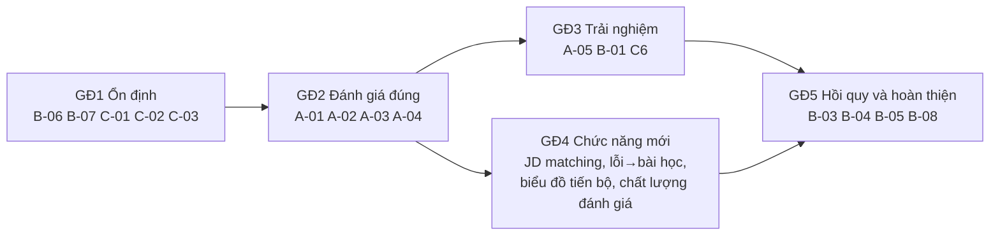

# Phần E. Điều chỉnh chức năng, ý tưởng mới và lộ trình cải thiện

Thuộc bộ báo cáo kiểm định ngày 12/11/2026. Tài liệu chính: [AUDIT_REPORT.md](../../AUDIT_REPORT.md).

## E1. Chức năng cần điều chỉnh

### Giữ nguyên

| Chức năng | Lý do |
|---|---|
| Tài khoản, phiên, CSRF, phân quyền | Đã kiểm thử kỹ, chặn đúng mọi thăm dò (Phần B, kịch bản 7) |
| Máy trạng thái quy trình và bài thi | Chống nộp hay chấm hai lần, không nhảy bước |
| Chạy SQL/Python thật để chấm | Đây là điểm khác biệt lớn nhất so với bài trắc nghiệm thông thường |
| Công thức Coverage/Gap/Readiness | Minh bạch, có khóa khi thiếu bằng chứng, có test |
| AI chỉ giải thích, không cộng điểm | Đúng nguyên tắc khách quan |
| Reset dạng lưu trữ và xóa dữ liệu riêng | An toàn dữ liệu |
| Lương có nguồn, xếp hạng ẩn danh, ngưỡng 5 người | Tránh số liệu giả và lộ danh tính |

### Sửa chữa

| Chức năng | Việc cần làm | Mã |
|---|---|---|
| Chọn độ khó bài đầu vào | Theo mức JD, không theo mức tự khai | A-01 |
| Chấm bài viết | Giới hạn điểm từ từ khóa, kiểm tra lập luận | A-02 |
| Trạng thái tuần trong lộ trình | Báo trễ và dời lịch | B-01 |
| Liên kết email, giới hạn theo IP | Cấu hình URL công khai và proxy tin cậy | B-06, B-07 |
| README, phiên bản thư viện | Cập nhật, khóa phiên bản | C-01, C-02 |

### Nâng cấp

| Chức năng | Hướng nâng cấp | Mã |
|---|---|---|
| Kiểm tra hoàn thành bài học | Thời gian chờ, câu thực hành cho mức ≥2 | A-03 |
| Ngân hàng đề | Sinh dữ liệu theo lượt, ≥3 câu mỗi ô | A-04 |
| Chấm bài | Hàng đợi nền | B-04 |
| Giám sát bài thi | Tín hiệu phía máy chủ cho admin | B-02 |
| Đánh giá AI | Bộ bài mẫu đo tỷ lệ phát hiện bài lách | B-08 |

### Thiết kế lại

| Chức năng | Lý do |
|---|---|
| Đổi mục tiêu (JD/nghề) | Hiện chỉ có reset toàn bộ; cần luồng giữ năng lực đã chứng minh (A-05) |
| Lớp lưu trữ trạng thái người học | Dict trong bộ nhớ + JSON không mở rộng được (B-03) |

### Loại bỏ hoặc thay thế

| Chức năng | Đề xuất | Lý do |
|---|---|---|
| Đường API trùng ở gốc (`/me/...`, `/jds/...` ngoài `/api/v1`) | Thay bằng chuyển hướng hoặc bỏ khỏi schema | Gấp đôi bề mặt API (C-03) |
| Nghề mô phỏng bấm được | Thay bằng thẻ "Sắp có" không bấm | Gây hiểu nhầm (C-07) |
| Các thẻ điều hướng lặp trên bảng điều khiển | Thay bằng một khối "Việc tiếp theo" | Giảm nhiễu (Phần C6) |

## E2. Ý tưởng chức năng mới

Đã đối chiếu với chức năng hiện có. Ý tưởng trùng thì ghi là "nâng cấp", không đề xuất làm mới.

### 1. Lộ trình theo lỗi cụ thể (Error-driven Learning)

| Mục | Nội dung |
|---|---|
| Cách hoạt động | Mỗi test case trượt trong bài thi (ví dụ "không bỏ dòng trùng", "sai phép chia phần trăm") gắn với 1 chủ đề con. Lộ trình ưu tiên bài học và bài luyện tập của đúng chủ đề đó, thay vì cả kỹ năng |
| Vấn đề giải quyết | Lộ trình hiện chọn theo mức kỹ năng; người sai một chi tiết nhỏ vẫn phải học cả khối |
| Lợi ích | Ngắn hơn, trúng chỗ yếu |
| Giá trị | Cá nhân hóa thật sự dựa trên bằng chứng, khác biệt rõ |
| Tích hợp | `test_case_results` đã lưu từng ý; thêm trường `topic` cho case trong `exam_items_v5.json` và `learning_objectives` ở activity; `roadmap_planner.plan_items` cộng điểm ưu tiên |
| Dữ liệu, công nghệ | Bảng ánh xạ case → chủ đề; không cần AI |
| Độ khó | Trung bình |
| Rủi ro | Cần đủ bài học cho từng chủ đề con |
| Ưu tiên | **Cao** |
| Trùng? | Không (nâng cấp `roadmap_planner`) |

### 2. So khớp nhiều JD (Job Matching)

| Mục | Nội dung |
|---|---|
| Cách hoạt động | Dùng mức đã xác thực để tính readiness với mọi JD trong thư viện (hiện 8 JD), xếp hạng, chỉ ra 1–2 kỹ năng còn thiếu cho mỗi JD |
| Vấn đề giải quyết | Người học chỉ thấy khoảng cách với một JD |
| Lợi ích | Biết nên ứng tuyển đâu trước |
| Giá trị | Tận dụng `gap_coverage` thuần hàm, chi phí thấp |
| Tích hợp | Endpoint mới đọc `jd_versions` + `evaluate_competency_framework`; trang mới trong Kế hoạch |
| Độ khó | Thấp |
| Rủi ro | JD thư viện ít; phải ghi rõ không phải xác suất trúng tuyển |
| Ưu tiên | **Cao** |
| Trùng? | Không (readiness hiện chỉ cho JD đang chọn) |

### 3. Bảng chất lượng đánh giá (Assessment Quality Dashboard)

| Mục | Nội dung |
|---|---|
| Cách hoạt động | Với mỗi câu thi: tỷ lệ đạt theo mức tự khai, độ phân biệt, tỷ lệ AI–máy lệch nhau, bài bị đưa đi duyệt; bộ bài mẫu đã gán mức để đo sai số sau mỗi lần sửa luật chấm |
| Vấn đề giải quyết | Chưa có cách đo khách quan độ chính xác đánh giá (Phần C3, câu 10) |
| Lợi ích | Nhóm chứng minh được hệ thống đánh giá đúng, không chỉ chạy được |
| Tích hợp | Mở rộng `admin/tests/item-analysis` sang câu thi 5.x; tái dùng ý tưởng `test_v4_reference_set.py` |
| Độ khó | Trung bình |
| Rủi ro | Cần đủ số bài thật để thống kê có ý nghĩa |
| Ưu tiên | **Cao** (với mục tiêu đồ án) |
| Trùng? | Một phần (item-analysis cho trắc nghiệm đã có) |

### 4. Biểu đồ tiến bộ từng kỹ năng (Skill Progress Analytics)

| Mục | Nội dung |
|---|---|
| Cách hoạt động | Đường mức theo thời gian cho từng kỹ năng, mỗi điểm bấm vào được để xem bằng chứng (bài thi, bài học, bài tổng hợp) |
| Vấn đề giải quyết | Hiện chỉ thấy mức hiện tại và lịch sử dạng danh sách |
| Tích hợp | API `/me/skill-history` đã có; thêm biểu đồ ở trang Tiến độ |
| Độ khó | Thấp |
| Ưu tiên | Trung bình |
| Trùng? | Nâng cấp |

### 5. Đánh giá Portfolio

| Mục | Nội dung |
|---|---|
| Cách hoạt động | Người học nộp liên kết notebook hoặc báo cáo dự án; chấm theo checklist cố định (có dữ liệu, có làm sạch, có biểu đồ có nhãn, có kết luận và giới hạn), AI trích dẫn bằng chứng, người duyệt quyết định |
| Vấn đề giải quyết | Người có kinh nghiệm (kịch bản 5) không có cách đưa bằng chứng ngoài bài thi |
| Tích hợp | `skill_evidence` với `source_type = PORTFOLIO`; hàng chờ duyệt admin đã có |
| Độ khó | Cao |
| Rủi ro | Bài không phải tự làm; cần người duyệt |
| Ưu tiên | Trung bình |
| Trùng? | Không |

### 6. Phỏng vấn thử (Mock Interview)

| Mục | Nội dung |
|---|---|
| Cách hoạt động | AI hỏi 5–8 câu theo JD, người học trả lời; nhận xét theo rubric STAR và kiến thức; **không** ghi bằng chứng kỹ năng |
| Vấn đề giải quyết | Chưa có luyện kỹ năng trình bày |
| Tích hợp | Một tác vụ mới trong `ai_service/task_engine.py` |
| Độ khó | Trung bình |
| Rủi ro | Phụ thuộc AI; nhận xét không ổn định; phải ghi rõ chỉ là luyện tập |
| Ưu tiên | Thấp–Trung bình |
| Trùng? | Không |

### 7. Đóng góp câu hỏi có kiểm duyệt

| Mục | Nội dung |
|---|---|
| Cách hoạt động | Vai trò "người đóng góp" gửi câu mới kèm đáp án mẫu; hệ thống chạy đáp án mẫu trên dữ liệu sinh ngẫu nhiên; admin duyệt mới đưa vào ngân hàng |
| Vấn đề giải quyết | Ngân hàng nhỏ (A-04) |
| Tích hợp | Quy trình duyệt tương tự kho kiến thức AI và JD |
| Độ khó | Trung bình |
| Ưu tiên | Trung bình (sau A-04) |
| Trùng? | Một phần (admin sửa câu đã có) |

### 8. Chỉ số sẵn sàng ứng tuyển, AI Career Advisor, Adaptive Assessment, Practical Assessment

- **Chỉ số sẵn sàng ứng tuyển:** trùng với Readiness hiện có. Không làm mới; chỉ thêm xu hướng theo thời gian vào ý tưởng 4.
- **AI Career Advisor:** trùng phần lớn với trợ lý AI hiện có (tác vụ phân tích JD, giải thích kết quả, phân tích kỹ năng). Nên nâng cấp bằng cách cho trợ lý gọi công cụ của ý tưởng 2 (so khớp nhiều JD).
- **Adaptive Assessment:** là hướng sửa của A-01; triển khai trong giai đoạn 2.
- **Practical Assessment:** đã có (SQL/Python chạy thật, 13 bài luyện tập). Nâng cấp bằng sinh dữ liệu (A-04).

## E3. Xếp hạng ý tưởng

Thang 1–5 (5 là tốt nhất; với chi phí, 5 là rẻ nhất).

| Ý tưởng | Giá trị người dùng | Khả thi | Phù hợp mục tiêu | Chi phí | Tổng |
|---|---|---|---|---|---|
| 2. So khớp nhiều JD | 5 | 5 | 5 | 5 | **20** |
| 4. Biểu đồ tiến bộ | 4 | 5 | 4 | 5 | **18** |
| 1. Lộ trình theo lỗi cụ thể | 5 | 4 | 5 | 3 | **17** |
| 3. Bảng chất lượng đánh giá | 3 | 4 | 5 | 3 | **15** |
| 7. Đóng góp câu hỏi | 2 | 3 | 4 | 3 | 12 |
| 5. Portfolio | 4 | 2 | 4 | 2 | 12 |
| 6. Phỏng vấn thử | 3 | 3 | 3 | 3 | 12 |

## E4. Lộ trình cải thiện

### Giai đoạn 1: Ổn định và an toàn triển khai (khoảng 1 tuần)

| Công việc | Phụ thuộc | Kết quả | Tiêu chí nghiệm thu |
|---|---|---|---|
| B-06 URL công khai cho email; TrustedHost ở production | – | Liên kết đúng miền | Test Host giả |
| B-07 Proxy tin cậy cho giới hạn tần suất | – | Giới hạn đúng từng người | Test hai IP sau proxy |
| C-02 Khóa phiên bản thư viện | – | Cài lại ra đúng môi trường | Cài mới trên máy sạch, 898 test đạt |
| C-03 Bỏ đường API trùng | Kiểm tra giao diện dùng đường nào | Một tiền tố | Không còn cảnh báo `operationId` |
| C-01 Cập nhật README | – | Tài liệu đúng 5.17 | Người mới làm theo README chạy được |

### Giai đoạn 2: Độ chính xác đánh giá năng lực (2–3 tuần, quan trọng nhất)

| Công việc | Phụ thuộc | Kết quả | Tiêu chí nghiệm thu |
|---|---|---|---|
| A-01 Độ khó theo mức JD | – | Không còn trần do tự khai | Đúng hết, không khai → đạt mức JD |
| A-02 Chống lách từ khóa | – | Bộ câu lách bị chặn | Bộ lách ≤ mức 1; đáp án mẫu vẫn 100 |
| A-04 Sinh dữ liệu theo lượt, thêm câu | A-02 (để câu mới có luật mới) | Đề khác nhau mỗi lượt | Đáp án mẫu đạt 100 trên 50 bộ dữ liệu ngẫu nhiên |
| A-03 Thời gian chờ, câu thực hành cho mức ≥2 | A-04 (cần thêm câu) | Mức sau lộ trình đáng tin | Không đạt mức 3 bằng trắc nghiệm |
| Ý tưởng 3 Bảng chất lượng đánh giá (bản đầu) | A-01, A-02 | Đo được sai số | Báo cáo sai số trên bộ bài mẫu |

### Giai đoạn 3: Trải nghiệm người dùng (1–2 tuần)

| Công việc | Phụ thuộc | Kết quả | Tiêu chí nghiệm thu |
|---|---|---|---|
| A-05 Luồng đổi mục tiêu giữ năng lực | A-01 (bài thi bổ sung dùng cùng cách chọn độ khó) | Kịch bản 4 làm được | Đổi JD không mất mức; gap và lộ trình cập nhật |
| B-01 Báo trễ, dời lịch | – | Lịch theo ngày thực | Test đồng hồ giả |
| C6 Bảng điều khiển "Việc tiếp theo", nghề "Sắp có", giải thích điểm | A-01 | Ít nhầm lẫn | Kiểm tra trên 375 px và 1280 px, sáng và tối |

### Giai đoạn 4: Chức năng mới giá trị cao (2–3 tuần)

| Công việc | Phụ thuộc | Kết quả | Tiêu chí nghiệm thu |
|---|---|---|---|
| Ý tưởng 2 So khớp nhiều JD | A-05 (cùng mô hình mục tiêu) | Danh sách JD phù hợp | Số liệu khớp trang Khoảng cách cho JD đang chọn |
| Ý tưởng 1 Lộ trình theo lỗi | A-04 (case có chủ đề) | Lộ trình trúng chỗ yếu | Hai người sai khác chủ đề nhận lộ trình khác nhau |
| Ý tưởng 4 Biểu đồ tiến bộ | – | Biểu đồ theo kỹ năng | Mỗi điểm dẫn tới bằng chứng |

### Giai đoạn 5: Hồi quy và hoàn thiện (1–2 tuần)

| Công việc | Phụ thuộc | Kết quả | Tiêu chí nghiệm thu |
|---|---|---|---|
| B-04 Chấm bài ở nền | – | API nộp nhanh | 10 bài đồng thời đều được chấm |
| B-03 Khóa phiên bản hồ sơ (bước đầu) | – | Không ghi đè khi hai tab | Test đồng thời |
| B-05 Container cho sandbox (nếu triển khai công khai) | – | Cách ly thật | `test_workspaces.py` đạt trong container |
| B-08 Chạy `test_ai_live.py` với khóa test, bộ đánh giá AI | A-02 | Có số liệu AI | Báo cáo tỷ lệ phát hiện bài lách |
| Chạy toàn bộ test, cài công cụ đo coverage (nếu nhóm đồng ý) | Tất cả | Báo cáo cuối | 0 test thất bại; coverage được ghi lại |
